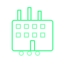

# IEEE ESSTHS IAS Chapter Website

A premium, industrial-themed website for the IEEE ESSTHS Student Branch Industry Applications Society (IAS) Chapter.

## Features

- **Industrial Motor Network Particle System**: An interactive hero with motor-inspired particles, electrical connections, and energy pulses that respond to mouse interaction
- **Industry-Focused Sections**: Applications, technical domains, events, resources
- **Event Management**: Data-driven event system with type-based filtering
- **Responsive Design**: Optimized for desktop, tablet, and mobile
- **Premium Dark Aesthetic**: Electric green color scheme with sophisticated animations
- **Accessibility**: Full keyboard navigation, reduced motion support, semantic HTML
- **Performance**: Optimized particle system, lazy loading, minimal dependencies

## Project Structure

```
ias/
├── index.html          # Main HTML structure
├── styles.css          # Complete styling and responsive design
├── main.js             # Interactive features and particle system
├── manifest.json       # PWA manifest
├── .gitignore          # Git ignore rules
└── README.md           # This file
```

## Quick Start

1. **Open `index.html`** in a modern web browser
2. No build process or server required—works on any static host

## Customization Guide

### 1. Update Chapter Information

Edit the following in `index.html`:

**Header Logo & Branding:**
```html
<a class="brand" href="#home" aria-label="IEEE ESSTHS IAS Chapter home">
  
  <span>IEEE ESSTHS<br />IAS CHAPTER</span>
</a>
```

Replace `../assets/ias-placeholder.svg` with your actual chapter logo.

**Contact Form Email:**
```html
<form class="contact-form" action="https://formsubmit.co/ajax/[YOUR-EMAIL]" method="POST">
```

Replace `[YOUR-EMAIL]` with your chapter contact email.

### 2. Add and Manage Events

Events are stored in an inline JSON manifest at the end of `index.html`:

```json
{
  "name": "Introduction to Motor Drives",
  "type": "workshop",        // workshop, seminar, or social
  "status": "upcoming",      // or "past"
  "date": "2026-09-15",
  "location": "Engineering Lab A",
  "mode": "in-person",       // or "online"
  "src": "../assets/event-placeholder.jpg"
}
```

**To add an event:**
1. Find the `<script id="events-manifest">` section at the bottom
2. Add a new object to the array
3. The page automatically renders upcoming and past events

**Example:**
```json
{
  "name": "Motor Control Systems Workshop",
  "type": "workshop",
  "status": "upcoming",
  "date": "2026-10-12",
  "location": "Engineering Lab B",
  "mode": "in-person",
  "src": "../assets/workshop-motor.jpg"
}
```

### 3. Update Section Content

All text content is directly editable in `index.html`. Key sections:

- **Hero Title**: Lines ~63-67
- **About Section**: Lines ~90-107
- **Industry Applications**: Lines ~118-170
- **Technical Domains**: Lines ~181-210
- **Resources Section**: Lines ~270-289
- **Contact Copy**: Lines ~293-298

### 4. Customize Industry Applications

The applications cards use background patterns. Modify in `styles.css`:

```css
.app-bg-1 { /* Industrial Power Systems */ }
.app-bg-2 { /* Motor Drives & Control */ }
.app-bg-3 { /* Manufacturing Systems */ }
.app-bg-4 { /* Industrial Automation */ }
.app-bg-5 { /* Electrical Safety */ }
```

### 5. Update Technical Domains

Edit domain items in the **[03] // Technical Domains** section:

```html
<div class="domain-item reveal-up">
  <span class="domain-label">POWER ELECTRONICS</span>
  <span class="domain-icon">⚡</span>
</div>
```

Change the label and emoji to match your focus areas.

### 6. Color System

All colors are defined as CSS variables in `styles.css`:

```css
:root {
  --void: #050806;                    /* Black background */
  --surface: #0B120D;                 /* Dark surface */
  --pulse: #39FF88;                   /* Electric green (primary) */
  --pulse-dim: #16A34A;               /* Darker green */
  --pulse-glow: #86EFAC;              /* Bright green highlights */
  --steel: #7A8A7D;                   /* Muted gray-green text */
  --white: #F5F5F5;                   /* Off-white text */
}
```

### 7. Replace Placeholder Assets

Replace these files with actual assets:

- `../assets/ias-placeholder.svg` → Your IAS chapter logo
- `../assets/event-placeholder.jpg` → Event featured images
- `../assets/ieee-icon.png` → Favicon (if using chapter-specific icon)

### 8. Update Footer Links

Edit external links in the footer:

```html
<a href="https://www.ieee-ias.org" target="_blank" rel="noopener">IEEE IAS</a>
<a href="https://www.ieee.org" target="_blank" rel="noopener">IEEE</a>
```

## Particle System Customization

The industrial motor network particle system can be customized in `main.js`:

```javascript
// Connection distance (pixels at which particles connect)
this.connectionDistance = 120;

// Particle count (scales with viewport)
const particleCount = this.width < 768 ? 32 : Math.min(this.width / 15, 120);

// Mouse influence radius
const influence = 80;

// Pulse spawn rate (currently 0.2%)
if (Math.random() < 0.002) { /* create pulse */ }
```

## Performance Tips

1. **Reduce particle count** on mobile for better performance
2. **Lazy load event images** if you have many events
3. **Minimize CSS** for production deployment
4. **Compress images** (PNG/JPG) before uploading
5. Use `prefers-reduced-motion` for accessibility

## Deployment

### GitHub Pages
1. Create a repository named `your-username.github.io`
2. Place `ias/` folder contents in the repository root
3. Push to main branch
4. Website available at `https://your-username.github.io/`

### Netlify
1. Connect your GitHub repository
2. Set build command: (none needed)
3. Set publish directory: `ias/`
4. Deploy

### Traditional Hosting
1. Upload `ias/` folder contents to your web server
2. Ensure the server supports static files (HTML, CSS, JS)
3. No special configuration needed

## Troubleshooting

**Particle system not showing?**
- Check that `<canvas class="particle-canvas" data-particles>` exists in hero section
- Verify `main.js` is loaded correctly
- Check browser console for JavaScript errors

**Events not displaying?**
- Verify JSON manifest at bottom of `index.html` is valid JSON
- Check that event dates are in `YYYY-MM-DD` format
- Ensure `status` is either `"upcoming"` or `"past"`

**Styling issues?**
- Clear browser cache (Ctrl+Shift+Delete)
- Check that `styles.css` path is correct: `<link rel="stylesheet" href="styles.css" />`
- Verify no CSS conflicts with other stylesheets

**Form not submitting?**
- Verify FormSubmit email is set: `action="https://formsubmit.co/ajax/[EMAIL]"`
- Check that email address is valid
- Ensure form has `method="POST"`

## Browser Support

- Chrome/Edge 90+
- Firefox 88+
- Safari 14+
- Mobile browsers (iOS Safari 14+, Chrome Mobile)

## License

IEEE ESSTHS Student Branch | 2026

## Support

For issues or questions about this website, contact your IAS Chapter webmaster or IEEE ESSTHS SB leadership.
